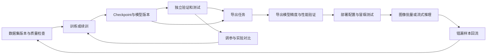

# Ultralytics 全流程适配评审与改造规格

评审日期：2026-10-22。源码基线：`4132e5f`；本地另有未跟踪的 YOLO11 baseline 算法包，本次保持原状。

本次完成官方在线文档、平台源码和平台 Dockerfile 指定的 Ultralytics `8.4.183` wheel 的静态对照。以下“已实现”表示存在对应实现，不代表本次完成服务器、浏览器或 GPU 验收。改造项尚未实现，本次只新增评审文档与参数清单。

后续进展（2026-10-23）：统一参数、数据集版本、模型来源/微调/续训、独立验证，以及 FP32 ONNX 独立导出与导出后验证已补充开发。以下保留最初评审基线；当前能力与验收边界以 [参数系统](PARAMETERS.md)、[数据版本](DATASETS.md)、[模型来源](TRAINING-SOURCES.md)、[独立验证](VALIDATION.md)、[生命周期验收](LIFECYCLE-VALIDATION.md)、[模型导出](EXPORTS.md)、[导出验收](EXPORT-VALIDATION.md)、[ONNX 部署与 RuntimeProfile](DEPLOYMENT-RUNTIME.md) 和 [部署验收](RUNTIME-VALIDATION.md) 为准。

当前 P2 已完成目标检测的 PyTorch → FP32 ONNX 子链路，包括目录产物登记、ONNX Runtime 冒烟、同集验证、精度质量检查和 CPU 微基准。P2 的 TensorRT/OpenVINO/TorchScript 等目标仍未完成。

P3 已接通不可变 ONNX 发布、CPU RuntimeProfile、Docker 资源/请求超时、ORT 线程/预热、加载就绪证据、服务默认参数/覆盖范围和确切部署实例推理。静态与动态空间尺寸支持单图服务，动态 batch 图也以 batch=1 调用；任务复用保留部署绑定。该子集已开发并在隔离服务器验证，不等于生产已经升级。服务版本路由、就绪后切换、在途请求排空、故障回滚、在线性能分位数观测（P50/P95/P99、QPS、队列等待与错误率）及推理样本一键回流生成新数据集版本已完成并纳入回归；后续优先推进真正模型 batch、视频/有状态跟踪、多任务扩展及更多运行后端。worker/并发/batch 等未支持字段会拒绝，不能把 P3/P4 标记为全部完成。

## 1. 结论

平台已有“检测数据集导入 → GPU 训练 → 查看指标 → 发布 checkpoint 为算法版本 → 定向部署 → 工作台推理”的基础闭环，适合在现有架构上扩展。

要覆盖完整使用过程，重点补齐：**版本化全量参数契约、数据集与模型版本管理、独立验证、断点续训、格式导出及导出后验证、部署运行配置、视频跟踪与实验调优**。

“所有参数可配置”的验收含义是：所选框架版本、任务、模型、运行模式、后端和硬件支持的参数，都有可表达、可校验、可传递、可回读的配置入口。模型、数据路径、输出目录、GPU 等参数用平台选择器映射；不要求用户填写容器路径。暂未适配的能力必须给出明确状态，不能接收后静默丢弃。

## 2. 文档与版本依据

本次直接读取以下官方页面，并核对 PyPI 固定版本的配置与实现：

- [配置总表](https://docs.ultralytics.com/zh/usage/cfg/)
- [训练](https://docs.ultralytics.com/zh/modes/train/)、[验证](https://docs.ultralytics.com/zh/modes/val/)、[预测](https://docs.ultralytics.com/zh/modes/predict/)
- [导出](https://docs.ultralytics.com/zh/modes/export/)、[跟踪](https://docs.ultralytics.com/zh/modes/track/)、[Benchmark](https://docs.ultralytics.com/zh/modes/benchmark/)
- [超参数调优](https://docs.ultralytics.com/zh/guides/hyperparameter-tuning/)
- [Ultralytics 8.4.183 发布元数据](https://pypi.org/pypi/ultralytics/8.4.183/json)

原始事实清单见 [ultralytics-8.4.183-audit-2026-10-22.json](research/ultralytics-8.4.183-audit-2026-10-22.json)。记录页面 URL/抓取内容哈希、wheel URL/SHA-256、本地文件哈希、参数名/类型/默认值、当前绑定方式、各导出后端参数矩阵、6 种 tracker 的默认配置。

该版本 `default.yaml` 有 **113 个顶层键**。文档表中训练及增强 83 项、验证 30 项、预测及输出 36 项、导出 20 项、Benchmark 8 项；不同模式有大量重叠，不能相加作为参数总数，也不能把这些行全部算成用户超参数。`stream/persist` 等 API 参数、`augmentations/save_dir` 等额外配置也需要单独登记。

导出矩阵有 23 条，包含原生 PyTorch 行，即 22 个目标导出格式。上游支持格式不等于平台已经具备相应转换环境和推理后端。

确认 `8.4.183` 已使用 `quantize` 统一精度设置；`half/int8` 保留为弃用兼容入口，`end2end` 也有向 `nms` 的兼容映射。必须按所选版本规范化，不能沿用旧版参数表。

## 3. 当前能力与缺口

| 环节 | 源码现状 | 状态与需要补齐的能力 |
| --- | --- | --- |
| 数据集 | ZIP 导入、检测标注检查、类别统计、内容校验值、节点复用；整理为检测 train/val | 部分实现：数据集版本、test 保留、可控划分、预览、严格校验、其他任务格式 |
| 训练 | YOLO26/YOLO11 各 n/s/m，远程 GPU、进度/曲线/日志、停止、结果下载 | 部分实现：全量参数、自定义模型/权重、多卡交互、CPU 选择、续训、实验对比 |
| 验证 | 训练过程指标；独立的跨算法评测模块 | 部分实现：独立 Ultralytics `val()`、完整 AP/分类别报告、测试集与导出模型复测 |
| 模型管理 | best/last 发布、版本、来源、训练指标、模型文件校验与同步、版本对比/回滚入口 | 已有基础：增加不可变模型产物、真实 checkpoint 元数据、运行环境和完整配置 |
| 导出 | 下载 `.pt`；已有独立 ONNX baseline 包可导入 | 全流程导出未实现：创建转换任务、参数/日志/进度、目录产物、转换后验证 |
| 部署 | 指定节点/GPU，准备镜像与权重，启动/停止/重部署、健康检查、实例定向推理 | 部分实现：后端/产物选择、资源/并发/精度配置、冒烟测试、服务发布与切换 |
| 推理 | 单图、任务批量提交、工作台结果、视频/流抽帧后逐图执行 | 部分实现：完整参数、真正模型 batch、流任务生命周期、带状态跟踪 |
| Benchmark | 多算法结果对比；已有平均耗时等运维指标 | 专项未实现：跨格式的精度/延迟/吞吐/显存可比基准 |
| Tune | 无独立调参任务 | 未实现：搜索空间、trial、预算、并发、最优配置复用 |

关键证据位置（行号对应本次源码基线）：

| 事实 | 源码 |
| --- | --- |
| 训练只开放 9 个参数 | `backend/src/cv_platform/modules/training/api.py:68` |
| Manager 另维护一套固定参数模型 | `services/algorithm-manager/src/algorithm_manager/training.py:45` |
| 运行器只传递固定清单，输出目录和绘图参数写死 | `runtimes/yolo-trainer/train.py:112` |
| 只允许 6 个预置基础模型，训练要求 GPU | `modules/training/domain.py`、`modules/training/service.py:99`（均位于 backend/src/cv_platform） |
| 多卡配置已有 API/Manager 基础，训练页面只选单张卡 | `frontend/src/views/TrainingView.vue:122`、`services/algorithm-manager/src/algorithm_manager/training.py:195` |
| 归档仅写 train/val；缺 val 时 test 会被用于 val | `backend/src/cv_platform/modules/training/datasets.py:270`、`:337` |
| 数据配置重建只保留检测所需字段 | `runtimes/yolo-trainer/train.py:34` |
| 发布固定为检测、PyTorch/GPU、5 个推理参数 | `backend/src/cv_platform/modules/training/publish.py:26` |
| YOLO 推理实际只映射 5 个模型参数 | `examples/yolo/src/yolo_algorithm/algorithm.py:46` |
| 参数契约只有 number/integer/boolean/string | `packages/algorithm-sdk/src/cv_algorithm_sdk/manifest.py:83`、`frontend/src/types/algorithm.ts:33` |
| 定向部署请求仅版本/节点/GPU | `backend/src/cv_platform/modules/deployments/targets.py:167` |
| 检测评测为 IoU=0.5 的 P/R/F1，而非完整 AP | `backend/src/cv_platform/modules/evaluations/metrics.py:69` |
| SDK 没有 OBB、语义分割、深度任务类型及 track_id | `packages/algorithm-sdk/src/cv_algorithm_sdk/enums.py:11`、`results.py:23` |

注意：现有 Docker/BentoML/KServe 部署清单生成与模型格式转换属于不同能力；Manager 的 Docker 镜像 export 也不是模型 `export()`。

## 4. 必须优先修正的使用问题

1. **学习率可能没有按界面生效。** 当前默认 `optimizer=auto`，运行时会自动选择 optimizer/lr0，忽略手填 lr0。界面需显示联动说明；显式选择优化器后允许控制对应超参数，并回显框架实际使用的数值。
2. **参数在三层被限制。** 只扩充前端不会生效，Backend、Manager 和 runner 都需要同步。目前训练模型直接继承 Pydantic BaseModel，未禁止额外字段；未知参数可能在解析时被忽略。统一设置未知参数报错，避免配置成功的假象。
3. **独立测试集无法沿现有导入链路保留。** 归档只写 train/val；有 test 无 val 时会用 test 做验证。应保存三份划分；没有 val 时提供明确的划分策略，保留独立 test 供最终验收。
4. **扩展任务需要保留数据语义。** 当前导入按检测处理，多边形标注可被检测训练消费，不表示支持分割训练。姿态需要 `kpt_shape/flip_idx` 等元数据，分类需要目录规则，OBB 需要对应坐标格式，不能统一转换为检测框。
5. **停止不等于可恢复。** 现有流程停止容器并收回已有产物，结束后清理节点工作目录；不能仅增加 `resume=true` 就宣称续训。需要 checkpoint 登记、恢复目录/参数、优化器状态验证和父子 run 关系。
6. **验证和线上预测需要不同配置。** 验证通常使用更低的 conf，AP 统计与日常阈值下的 P/R 也不同。不能把工作台默认阈值直接当作训练评估口径。

## 5. 全量参数系统

### 5.1 共用、版本化的契约

建立独立 runtime contract，以 `adapter + framework_version + mode + task + backend` 标识能力；同一份契约服务前端表单、Backend 校验、Manager 校验和 runner 参数解析。平台其他算法仍走适配器机制，不把整个平台绑定到 YOLO。

不能只根据 `default.yaml` 的默认值推断字段类型：None、联合类型、特殊取值、额外 API 参数和后端限制都需要从固定版本配置、函数签名与补充元数据一起生成/维护。构建 runtime 镜像时验证并发布契约，平台通过能力查询读取；主 Backend 不需要因此安装 PyTorch。

契约至少包含：

- 原始参数名、中文名称、说明、默认值来源、分组、可搜索标签。
- scalar、nullable、array、object、enum、联合类型；上下界、长度、互斥和依赖规则。
- 支持模式、任务、模型头、硬件、格式、所需依赖、版本范围、弃用映射。
- 用户字段/平台选择器/平台映射字段，以及规范化后的真实运行值。

建议用 JSON Schema 的结构性能力统一表达，UI 展示元数据与运行约束分开保存。现有算法 manifest 1.0 继续兼容，新结构使用明确的新版本，避免旧包被破坏。

### 5.2 参数面板

提供“常用参数 / 全部参数 / YAML或JSON”三种视图，编辑同一份配置，双向同步。支持搜索原始参数名、中文说明、只看修改项、恢复默认、配置模板、复制已有实验、导入导出、配置差异。

所有合法参数都可在全部参数或专家配置中设置，不要求每项都有专用滑块；列表、联合类型、可空值和对象必须保持类型，不能用逗号字符串代替数组。对 None/False/0/未提供作明确区分。

模型、预训练权重、教师模型、数据集、校准集用资源选择器；支持上传或登记自定义权重/模型 YAML。输出目录由平台映射到本 run 的产物目录并展示真实路径；`name` 在导出模式可能表示硬件型号，应使用该模式的含义。

### 5.3 参数分组与范围

以下为主要分组和代表字段；**完整字段以随附 JSON 清单和固定版本能力契约为准**，不是只实现表中的例子。

| 模式/分组 | 应提供的配置 |
| --- | --- |
| 训练基础 | model、data、epochs、time、patience、batch、imgsz、pretrained、cls_remap、device、workers |
| 优化与调度 | optimizer（包含固定版本支持的全部选项）、lr0、lrf、momentum、weight_decay、warmup_*、cos_lr、nbs |
| 训练行为 | amp、quantize、compile、channels_last、deterministic、seed、freeze、fraction、rect、multi_scale、single_cls、classes、profile |
| 损失与任务 | box、cls、cls_pw、dfl、pose、kobj、rle、angle、overlap_mask、mask_ratio、dropout；depth 的 dlog/dgrad/dlam 按任务启用 |
| 蒸馏 | distill_model、dis，以及教师产物的版本与兼容信息 |
| 数据增强 | hsv_h/s/v、degrees、translate、scale、shear、perspective、flipud/fliplr、bgr、mosaic、mixup、cutmix、copy_paste、copy_paste_mode、close_mosaic、auto_augment、erasing、augmentations |
| 保存与训练验证 | save、save_period、val、plots、verbose、cache、resume、project/name/save_dir/exist_ok 的受管映射 |
| 独立验证 | data、split、batch、imgsz、conf、iou、max_det、classes、single_cls、rect、quantize、device、workers、dnn、augment、nms、save_json/txt/conf、visualize、compile 等 |
| 推理 | conf、iou、imgsz、max_det、classes、batch、rect、quantize、device、dnn、augment、agnostic_nms、nms、retina_masks、embed、compile、channels_last |
| 视频与输出 | source、stream、vid_stride、stream_buffer；save、save_frames、save_txt、save_conf、save_crop、show_labels/conf/boxes、line_width 等 |
| 导出 | format、硬件 target/name、imgsz、batch、quantize、dynamic、simplify、opset、workspace、nms、conf、iou、max_det、agnostic_nms、device、data、split、fraction、optimize、verbose |
| 跟踪 | tracker、persist；所选 tracker 配置的所有合法键，如匹配阈值、track_buffer、gmc、ReID；继承适用推理参数 |
| Benchmark | model、data、imgsz、quantize、device、format、verbose、eps，以及所选后端允许的附加配置 |
| Tune | 训练配置、iterations、use_ray、space，以及所选搜索后端的预算/恢复/存储配置 |

训练 batch 应支持正整数、-1、显存占比小数；训练/验证 imgsz 与 predict/export 的形状规则分别校验。默认值随模式和模型改变，不能把同一组默认值复制到所有模式。

自定义增强以结构化变换配置表达，由受支持的 adapter 构造实例；函数/callback 扩展放入版本化插件。若某能力需要额外依赖，应显示依赖状态并提供对应 runtime。

### 5.4 不能省略的联动规则

- 多卡 DDP 禁用不支持的 AutoBatch；检查 batch 与卡数，提示 rect 的兼容限制，记录框架调整结果。
- `optimizer=auto` 明示 lr0 自动决定；resume 仅允许该版本允许覆盖的参数，其他变更转为“基于 checkpoint 新建微调”。
- `amp` 支持版本实际接受的 bool/precision 选项；`quantize` 区分训练 QAT、推理精度和导出 PTQ，不把 INT8 当成任意推理文件的临时开关。
- cache=disk 与只读数据集挂载冲突时使用可写缓存区；cache=ram 预检内存；profile/compile/蒸馏/自定义增强检查所需依赖与组合限制。
- `save=false` 提示不产生可发布 checkpoint；`val=false` 或无验证指标时不显示不存在的最优精度。
- nms=None/True/False 按模型头和模式解释；无 NMS 头上的 iou/agnostic_nms 语义不能与普通 NMS 一概而论。
- 导出按 format-specific 参数矩阵校验；INT8/PTQ 需要明确的校准数据版本和划分，QAT 自带范围的 checkpoint 则按版本实现处理。
- 固定形状产物的 imgsz/batch 和嵌入 NMS 的阈值约束要在部署/推理页面显示，不能让用户修改无效参数。

### 5.5 配置生效证据

保存三层信息：提交配置、规范化后的任务配置、框架实际使用配置。运行阶段回传实际 optimizer/lr、batch、设备、精度、输入尺寸、框架对参数的修改及原因。

配置优先级定义为：固定版本默认 → 平台模板 → 用户覆盖 → 平台资源映射 → 框架实际调整。资源映射只处理受管字段，若用户配置冲突应明确报错或显示覆盖原因。保存 schema/version/hash、运行镜像 digest、数据/权重哈希；日志之外也能查询。

## 6. 完整工作流与页面

PyTorch 原生部署允许跳过导出，但仍需选择清晰的模型产物与验证记录。

页面建议沿用现有训练中心、算法库、模型部署和工作台，增加数据集详情、实验对比、独立验证详情、导出任务详情、部署配置详情；把它们通过来源链接串起来，不必重新建一套孤立导航。

### 6.1 数据集与实验

保存原始上传文件与规范化版本，分别记录内容哈希、类别映射、任务格式、train/val/test 划分、修复报告。增加图片/标注预览、类别分布、异常标签及重复/泄漏检查；提供严格拒绝与可审计修复模式。

自动划分支持比例、seed、按类别分层、按视频/拍摄批次分组，避免相邻帧跨训练与验证集。数据集版本被训练引用后不可原地改写。

训练任务支持预训练、从模型 YAML 新建、自定义 checkpoint 微调、真正续训；多卡选择；资源与预计成本；曲线、GPU/显存、当前实际配置；配置模板与实验对比。

### 6.2 续训与模型来源

分清“恢复中断训练”和“用旧权重开始新训练”。前者需要恢复 epoch、optimizer/scaler/EMA 等状态，并遵守版本允许修改的参数范围；后者生成新的实验和数据/配置快照。

上游自然完成训练后可能清理 checkpoint 中的优化器状态，不能假设任意 last.pt 都能原样 resume。登记 `resumable`、完整状态是否存在、parent_run/checkpoint；清理节点前确保恢复材料已保留。

发布来源继续保留现有 lineage，再补 checkpoint hash、实际 checkpoint 指标/epoch、完整参数、训练/数据版本、框架/依赖/镜像版本。模型产物与训练记录解耦，删除训练记录不删除已发布模型。

### 6.3 独立验证

新增 Ultralytics 原生验证任务，输入可选 checkpoint 或导出产物、数据集版本、split 和完整验证配置。产出 AP50/AP50-95、按类别统计、PR/混淆矩阵、错误样例与耗时；按任务切换 mask/pose/OBB/classification 等指标。

保留现有跨算法评测模块，在页面标明指标定义和阈值；不可把 IoU50 下的 P/R/F1 标成 mAP。记录评估版本与预处理，公平对比统一数据、阈值和硬件。

### 6.4 导出与导出后验证

建立独立 ExportJob，具有排队、准备、转换、验证、完成/失败/取消状态，复用现有节点传输与日志设施。

优先完成 PyTorch → ONNX、TensorRT、OpenVINO、TorchScript。其余目标也纳入完整能力目录，按环境逐项适配；不支持的环境显示具体缺失依赖。导出任务可以路由到具备目标工具链的节点。

每个产物记录源 checkpoint、format、真实精度、shape/batch/dynamic、opset、NMS 方式、类别与预处理、依赖/驱动/GPU 等兼容信息，支持目录型产物和所有合法后缀。

现有训练产物扫描只接收 `.pt/.csv/.yaml/.png/.jpg`，并限制目录层级。应为导出建立独立的产物登记与下载/同步机制，不能只把 `.onnx/.engine` 添进该白名单。

导出完成后在目标运行时加载，做冒烟推理和同集精度比较，再记录延迟、吞吐、显存、体积和转换误差。TensorRT engine 的跨 GPU/驱动/运行时可用性按元数据判断并实测；不承诺一个 engine 随处可运行。

### 6.5 部署与推理

部署输入由“算法版本”扩展为明确的模型产物与 RuntimeProfile，后者包含运行时、CPU/GPU、内存/共享内存、worker、并发、batch、超时、预热、服务默认参数与允许覆盖范围。现有 Manager 已有部分底层资源能力，应打通到部署 API/持久化/页面。

部署流程在已有健康检查后加入模型加载、真实样例推理、资源检查与通过/失败证据。提供受鉴权的服务调用示例、凭证管理和服务版本路由；现有版本回滚基础继续复用，新增就绪后切换、排空旧请求和异常恢复。

推理界面按产物能力生成参数。保留旧 confidence/iou_threshold/max_detections/image_size 的兼容映射，对应规范名 conf/iou/max_det/imgsz；新版持久化规范参数与原始提交值。

图片批量应提供真正模型 batch，区别于当前逐图片任务队列。视频/RTSP 提供采样、限流、断流重连、buffer、运行时长、停止和结果导出。跟踪任务保持每个流独立状态，输出 track_id/轨迹，不能把无状态逐帧检测称作 tracking。

部署运维在已有健康/平均耗时基础上增加端到端 P50/P95/P99、QPS、队列等待、错误率、显存、掉帧/流延迟和运行版本；支持错漏样本回流形成新数据集版本。

## 7. 分阶段交付

| 阶段 | 交付物 | 验收标准 |
| --- | --- | --- |
| P0 参数契约 | 固定版本能力目录、结构化/专家表单、Backend/Manager 共用校验、runner 透传与实际参数回显 | 清单中的每项都有明确绑定/限制；未知字段报错；复杂类型不丢失；没有界面有值而运行器漏传 |
| P1 数据与训练 | test 保留、数据版本/预览、检测全量参数、自定义权重/模型、多卡交互、续训/微调区分 | 真实 GPU 训练验证新增参数；重启/停止后可按登记状态恢复；实验配置可复现 |
| P2 验证与导出 | 独立 val、ExportJob、首批后端、目录产物、转换后精度比较与 Benchmark | 同一 checkpoint → 原生验证 → 导出 → 目标运行时验证的证据链完整 |
| P3 部署与推理 | 产物/运行配置选择、资源控制、冒烟与服务切换、完整预测参数、模型 batch | 指定节点部署成功；参数生效；真实调用与故障/回滚验证；性能报告可追溯 |
| P4 能力扩展 | segment/classify/pose/OBB 训练与对应数据/结果适配、stateful track、Tune；更多导出目标 | 每个任务走完数据到部署；跟踪跨帧 ID 有效；调参最优配置可复用 |

如果目标是覆盖当前 Ultralytics 全部原生任务，还需规划 semantic/depth 的数据、训练、评估和渲染协议。OCR 是平台已有任务，继续独立保留。Solutions 中的计数、区域、测速等业务配置及外部集成使用插件扩展，不混入训练模型参数。

优先保证检测的完整链路可配置和可验证，再按同一契约拓展任务；最终验收仍需覆盖所有承诺支持的任务与后端，不能用“参数面板已增加”替代完成标准。

## 8. 代码落点与验收清单

推荐在现有模块中扩展，新增模块名为建议方案：

| 位置 | 工作 |
| --- | --- |
| `packages/algorithm-sdk` 或独立 runtime-contracts 包 | 参数复杂类型、版本契约、能力描述；向后兼容 |
| `backend/.../training`、Manager training、`runtimes/yolo-trainer` | 共享解析、资源映射、续训、真实配置回传、任务适配器 |
| `backend/.../training/datasets.py` | 三划分、版本、元数据、按任务导入与校验 |
| 新增 validation/exports/benchmarks/tuning 模块 | 独立作业状态与结果，复用节点/产物传输设施 |
| `backend/.../deployments`、instances、推理适配器 | 产物选择、运行资源、服务配置、生效证据 |
| `frontend/.../ParameterForm.vue` 与参数工具 | 数组/对象/null/联合类型、搜索、分组、专家配置 |
| 现有训练/部署/工作台页面 | 消费契约、展示完整生命周期来源、配置与差异 |
| `database/migrations` | 增量迁移与历史记录兼容，保留现有训练/算法/部署关系 |

必须执行的功能验收包括：

1. 字段覆盖自动检查：每个承诺支持的参数都有 schema、绑定、兼容说明；新旧版本差异有报告。
2. 配置 round-trip：默认/覆盖/null/False/0/数组/对象/别名经 UI→Backend→Manager→runner→存储回读保持语义。
3. 关键联动：auto optimizer、fractional batch、DDP、resume、precision、NMS、动态形状、校准集与缓存限制。
4. 真机检测链路：自定义数据 → 训练/中断恢复 → 独立 test → 多格式导出 → 复测 → 指定 GPU/CPU 部署 → API 推理。
5. 任务扩展：分割、分类、姿态、OBB 等分别验证正确的数据与输出，不能借用检测流程代验。
6. 故障与兼容：节点断连、OOM、导出依赖缺失、格式不兼容、服务切换失败；历史参数/算法包/模型版本仍可用。

本次校验仅覆盖文档链接、配置清单结构、参数数量及源码映射一致性。没有启动训练、导出、部署或修改远程服务；本机既有 `.venv` 指向缺失的 `C:\Python314\python.exe`，未据此声称应用测试通过。
